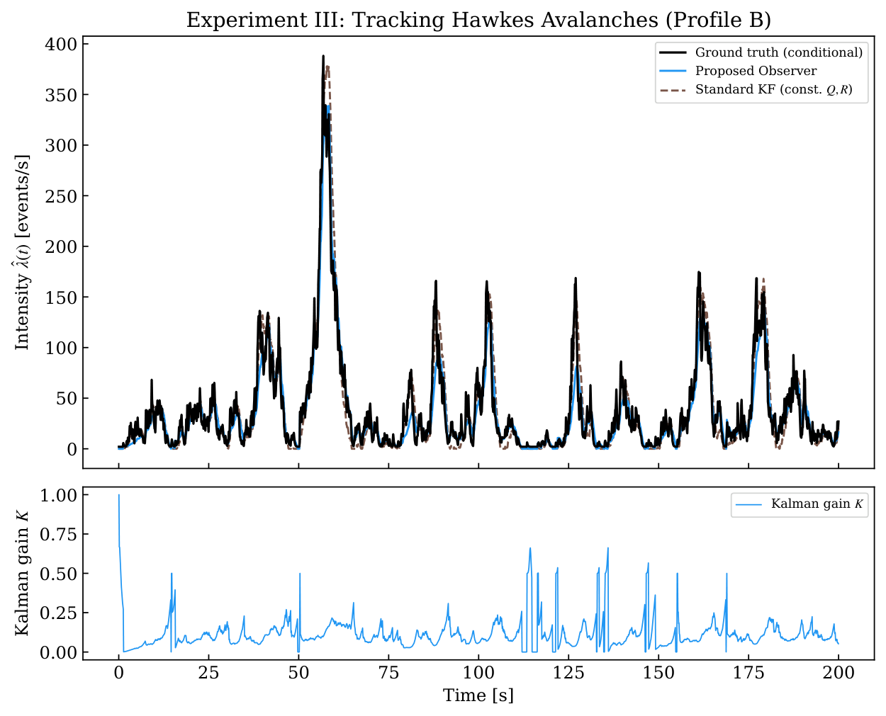
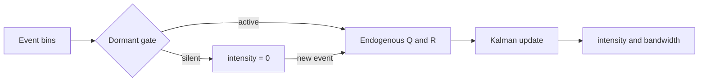
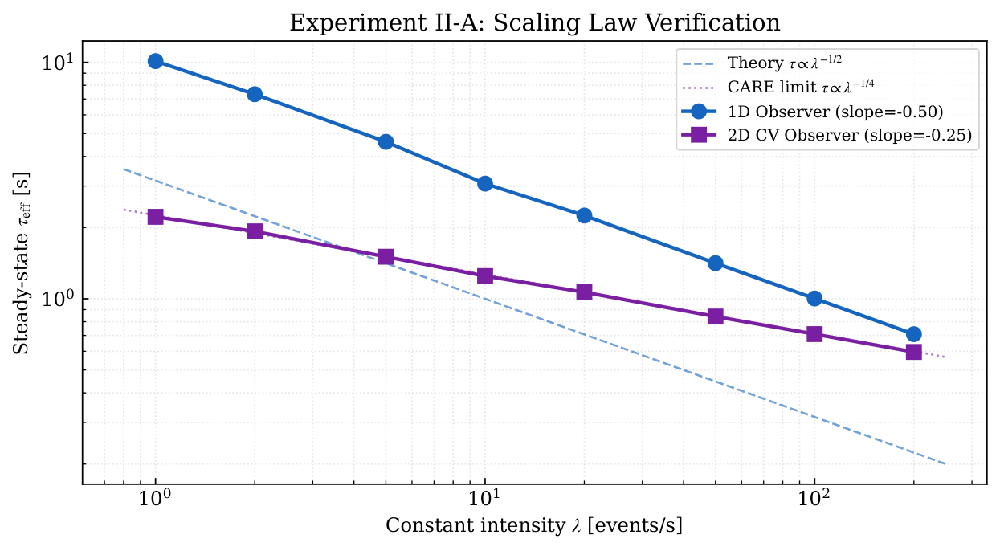
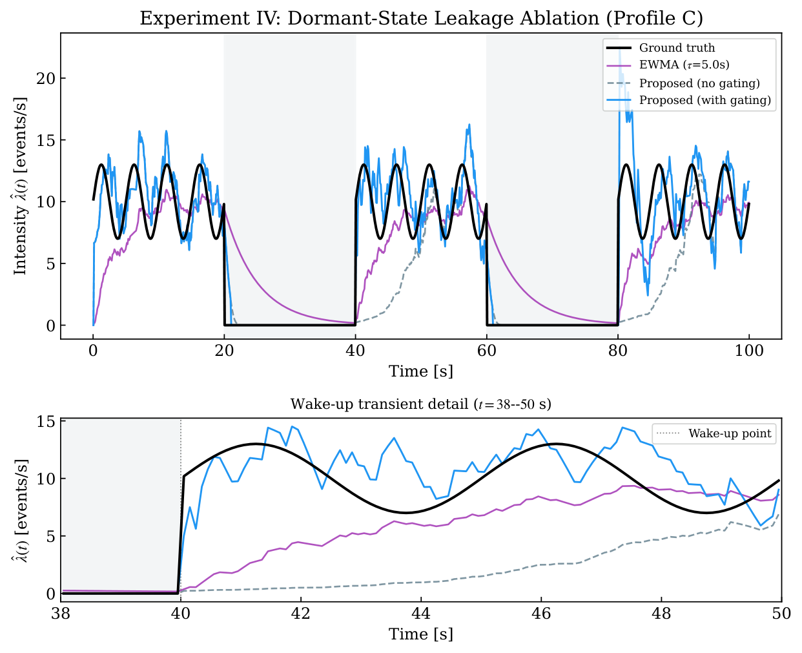

<div align="center">

# CAIE

**Causal Adaptive Intensity Estimation** for non-stationary point processes

[](https://github.com/chin1hanwu/CAIE-Kalman-Kernel-Duality-Code/actions/workflows/ci.yml)
[](LICENSE)
[](https://www.python.org/)

Companion code for the manuscript<br>
*Causal Adaptive Intensity Estimation for Non-Stationary Point Processes:<br>A Kalman–Kernel Duality Framework*

面向非平稳点过程的因果自适应强度估计：将 Poisson 计数统计写入 Kalman 噪声，使有效核带宽随强度自动调节，每步 O(1)。

</div>

---

A streaming point process arrives as irregular timestamps. This repository estimates the instantaneous rate $\hat\lambda(t)$ with a Kalman observer whose noise is written from the counting statistics themselves. The algebraic Riccati equation then yields Abramson's square-root bandwidth law in a **causal, $O(1)$-per-bin** recursion — no pilot estimate, no future events, no $O(N^2)$ kernel sum.

<p align="center">
  
</p>
<p align="center"><sub>Near-critical Hawkes avalanches (Profile B): the observer tracks the conditional intensity, and the Kalman gain rises on each burst.</sub></p>

## Highlights

| Feature | Detail |
| --- | --- |
| Causal, constant-time | One predict–update step per bin. Suitable for streaming inference. |
| Two observers | `AdaptiveObserver1D` recovers τ ∝ λ<sup>−1/2</sup>. `AdaptiveObserver` is the 2D constant-velocity model with τ ∝ λ<sup>−1/4</sup>. |
| Dormant-state gating | Prolonged silence is treated as a structural zero rather than a slow IIR decay. |
| Baselines in one place | Reciprocal 1/δt, fixed-bandwidth EWMA, constant-(Q, R) Kalman, and offline Oracle Abramson KDE. |
| Paper experiments | Four synthetic studies plus optional neuroscience and finance loaders. Data are not bundled. |

## How it works

Bin the stream at width $\Delta t$. The measurement is the raw rate $z_k=\Delta N_k/\Delta t$. While the filter is active, Poisson counting and scale-invariant volatility set the noise:

$$
R_k = R_0 + \varphi\,\hat\lambda/\Delta t
$$

Process noise is $Q_k = q\,\hat\lambda^2\,\Delta t$ in the 1D random-walk model and $Q_k = q\,\hat\lambda^2\,G$ in the 2D constant-velocity model.

The steady-state gain then behaves like a causal exponential kernel whose effective bandwidth shrinks in busy regions and widens in quiet ones. If the silence since the last event exceeds the Poisson survival threshold $T_{\mathrm{gap}}=-\log(\alpha_g)/\lambda_{\mathrm{anchor}}$, the observer enters a dormant state, reports $\hat\lambda=0$, and re-inflates its covariance on the next arrival.



<p align="center">
  
</p>
<p align="center"><sub>Measured steady-state bandwidth versus intensity. The 1D observer follows $\lambda^{-1/2}$; the 2D CV observer follows $\lambda^{-1/4}$.</sub></p>

Use **`AdaptiveObserver`** for applications. Use **`AdaptiveObserver1D`** when you need the scalar theorem, the $\lambda^{-1/2}$ check, or the finance predictive-likelihood protocol.

## Estimators

| Method | Causal | Cost | Bandwidth | Structural zeros |
| --- | :---: | :---: | --- | --- |
| `AdaptiveObserver1D` | yes | O(1) | ∝ λ<sup>−1/2</sup> | dormant gate |
| `AdaptiveObserver` | yes | O(1) | ∝ λ<sup>−1/4</sup> | dormant gate |
| EWMA | yes | O(1) | fixed τ | no |
| Standard Kalman | yes | O(1) | fixed Q, R | no |
| Reciprocal 1/δt | yes | O(1) | none | no |
| Oracle adaptive KDE | no | O(N²) | Abramson pilot | n/a |

The Oracle KDE is an offline upper reference, not a streaming baseline.

## Install

Python 3.10–3.13. From the repository root:

```bash
python -m venv .venv

# Windows PowerShell
.\.venv\Scripts\Activate.ps1
# Windows Git Bash:  source .venv/Scripts/activate
# Linux / macOS:     source .venv/bin/activate

python -m pip install -r requirements.txt
python examples/quickstart.py
python -m unittest discover -s tests -v
```

Core dependencies are NumPy, SciPy, and Matplotlib. Headless machines should set `MPLBACKEND=Agg`. Neural-data scripts need an extra install:

```bash
python -m pip install -r requirements-neuro.txt
```

CI runs the core tests on Linux (Python 3.10, 3.12, 3.13) and Windows (Python 3.13), plus a separate job for the optional NWB interface.

## Quick start

`examples/quickstart.py` generates a piecewise-constant Poisson rate, runs both observers, and prints RMSE. A minimal variant:

```python
import sys
from pathlib import Path
import numpy as np

sys.path.insert(0, str(Path("src").resolve()))

from config import DT, R0, PHI, Q_SCALE, ALPHA_G, EPS, P_INIT
from observer import AdaptiveObserver

rng = np.random.default_rng(42)
true_rate = np.repeat([5.0, 20.0, 5.0], 200)   # events / s
counts = rng.poisson(true_rate * DT)           # events in each bin

obs = AdaptiveObserver(DT, R0, PHI, Q_SCALE, ALPHA_G, EPS, P_INIT)
lam_hat = obs.process_sequence(counts)

rmse = float(np.sqrt(np.mean((lam_hat - true_rate) ** 2)))
print(f"bins={len(counts)}  RMSE={rmse:.3f} events/s")
```

`counts[k]` is the event count in bin $k$ of width `DT`. The returned intensity is in **events per second**.

## Using the observer

`process_sequence(counts)` always resets internal state. For a live stream, call `step(k, count)` with a 1-based index `k`:

```python
obs = AdaptiveObserver(DT, R0, PHI, Q_SCALE, ALPHA_G, EPS, P_INIT)
for k, count in enumerate(counts, start=1):
    lam_k = obs.step(k, count)
```

After a pass, `obs.history` holds aligned traces:

| Key | Meaning |
| --- | --- |
| `lambda_hat` | posterior intensity after the current update |
| `lambda_dot` | intensity rate (2D only) |
| `K_gain` | position-channel Kalman gain |
| `tau_eff` | effective exponential bandwidth |
| `dormant_flag` | `True` while the gate is closed |

Constructor knobs beyond the paper defaults in `src/config.py`:

| Argument | Default | Role |
| --- | --- | --- |
| `enable_gating` | `True` | dormant-state logic |
| `innov_clip` | `-1` (off) | innovation saturation, in √S units |
| `T_gap_min` | `1.0` s | lower bound on the silence threshold |

Predictive log-likelihood and time-rescaling diagnostics must use the **pre-update** intensity $\hat\lambda_{k\mid k-1}$. Tracking RMSE against a known synthetic rate may use the posterior. See `src/app_finance.py` and `src/app_neuro.py` for the one-step-ahead protocol.

## Reproduce the paper experiments

Synthetic figures are written to `figures/`. From the repository root:

```bash
python src/run_section6.py
```

Each study can also be run on its own:

| Script | Study | What you should see |
| --- | --- | --- |
| `src/exp1_reciprocal_divergence.py` | I | Reciprocal 1/δt bias on Gamma renewals; observer stays near 1 |
| `src/exp2_bandwidth_adaptation.py` | II | Scaling-law slopes and NHPP tracking versus EWMA / KF / Oracle KDE |
| `src/exp3_hawkes_avalanche.py` | III | Self-exciting avalanches versus a constant-noise Kalman filter |
| `src/exp4_leakage_ablation.py` | IV | Phantom leakage in silent windows, with and without gating |

<p align="center">
  
</p>
<p align="center"><sub>Intermittent NHPP (Profile C). Gating reports zero in the silent windows; EWMA and the ungated observer leak residual intensity.</sub></p>

Experiment I draws many Gamma-renewal replications and is the slowest synthetic job. Oracle KDE and the $N=10^6$ runtime sweep in `src/app_complexity.py` are also expensive. Defaults live in `src/config.py` (`DT`, `SEED`, observer parameters, and Profiles A–C).

Cross-domain scripts expect **local** data and do not download anything:

```bash
python src/app_neuro.py          # DANDI 000128 / MC_Maze NWB
python src/app_finance.py        # Binance BTCUSDT aggTrades CSV
python src/app_complexity.py     # synthetic Poisson runtime sweep
# or, after the files below are in place:
python src/run_section7.py
```

Wall-clock numbers depend on the machine and the Matplotlib backend.

## Optional external data

This repository ships **no** event data and does not fetch any. Obtain files under the provider's license, then place them at the paths the loaders already know.

**Finance** — [Binance Public Data](https://github.com/binance/binance-public-data) spot aggTrades, headerless CSV:

```text
data/finance/BTCUSDT-aggTrades-2025-10-10.csv
data/finance/BTCUSDT-aggTrades-2025-10-11.csv
```

Column 1 is price, column 2 is quantity, column 5 is the timestamp (0-based). Microsecond stamps used by Binance spot from 2025 onward are converted to seconds relative to **00:00 UTC on 2025-10-10**.

**Neuroscience** — [DANDI 000128 / MC_Maze](https://dandiarchive.org/dandiset/000128), after `requirements-neuro.txt`:

```text
data/neuro/sub-Jenkins_ses-full_desc-train_behavior+ecephys.nwb
```

CI checks the NWB loader on a tiny synthetic file. End-to-end Section 7 numbers require the real recordings.

## Repository map

```text
.
├── examples/quickstart.py     no-data smoke example
├── src/
│   ├── observer.py            1D random-walk and 2D CV observers
│   ├── baselines.py           EWMA, standard KF, reciprocal, Oracle KDE
│   ├── data_gen.py            NHPP, Hawkes, Gamma renewal, binning
│   ├── config.py              Δt, seed, observer and profile defaults
│   ├── metrics.py             RMSE, MISE, lag, leakage mass
│   ├── metrics_realworld.py   predictive log-lik, time rescaling, decode R²
│   ├── exp1_*.py … exp4_*.py  synthetic studies
│   ├── app_neuro.py           MC_Maze analysis
│   ├── app_finance.py         BTCUSDT arrival-rate analysis
│   ├── app_complexity.py      Observer vs Oracle KDE runtime
│   └── run_section6.py        run all four synthetic studies
├── tests/test_core.py         observers, metrics, loaders, reduced plots
└── docs/assets/               README figures
```

This is a research tree, not an installable package. Scripts add `src/` to `sys.path`; you can also set `PYTHONPATH=src`.

## Citation

If you use this code, please cite the manuscript:

```bibtex
@unpublished{qin2026caie,
  title     = {Causal Adaptive Intensity Estimation for Non-Stationary
               Point Processes: A Kalman-Kernel Duality Framework},
  author    = {Qin, Hanwu and Wang, Dianhai and Zhang, Meng
               and You, Huangjun and Cai, Zhengyi},
  year      = {2026},
  note      = {Manuscript}
}
```

## License

Code is released under the [Apache License 2.0](LICENSE). Copyright and attribution are in [NOTICE](NOTICE). Third-party libraries and any external datasets remain under their own terms.

Supported in part by NSFC (52072340, 72431009) and the Zhejiang “Pioneer” and “Leading Goose” R&D Program (2024C03271).
